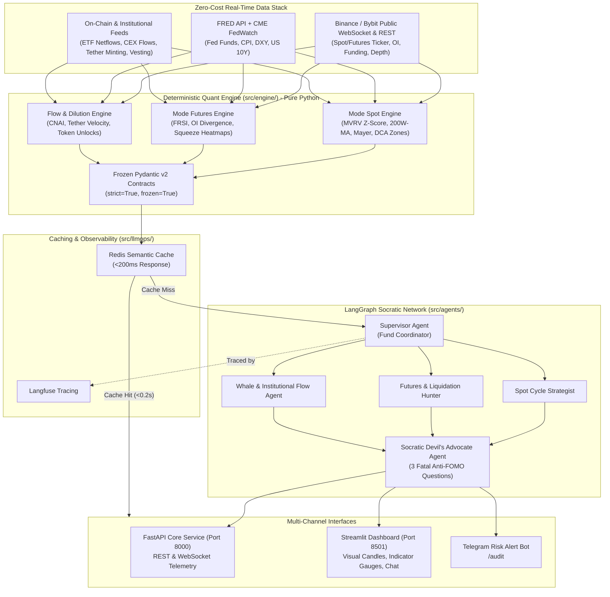

# CryptoIntel-Engine

> **Dual-Engine Crypto Intelligence: Spot Cycle Valuation, Real-time Futures Risk & Multi-Agent Socratic Auditing Platform**

[](https://www.python.org/downloads/)
[](https://docs.pydantic.dev/)
[](https://langchain-ai.github.io/langgraph/)
[](https://fastapi.tiangolo.com/)
[](https://streamlit.io/)
[](https://core.telegram.org/bots)
[](https://github.com/confident-ai/deepeval)

---

## 1. Executive Summary & Dual-Engine Product Vision

**CryptoIntel-Engine** is an institutional-grade, anti-FOMO decision support platform designed to prevent crypto investors from buying cycle tops and panic-selling bottoms. Operating as an **Independent Investment Committee** and **Socratic Devil's Advocate**, the platform features two distinct specialized operational modes:

### 🌟 Mode Spot (Long-Term Investment & Smart Accumulation)
- **Cycle Top & Bottom Identification**: Leverages quantitative on-chain metrics: MVRV Z-Score, Realized Price, 200-Week Moving Average, Mayer Multiple, and Pi Cycle.
- **Algorithmic Accumulation & Take-Profit Zones**: Programmatically derives mathematically grounded DCA Buy Zones and Take-Profit Tariffs instead of emotional guessing.
- **Supply Dilution & Institutional Flows**: Real-time tracking of Token Unlock Vesting cliffs (DeFiLlama/TokenUnlocks) and Spot Bitcoin/ETH ETF net flows (BlackRock, Fidelity).

### ⚡ Mode Futures (Short-Term Leverage & Squeeze Defense)
- **Real-Time Derivatives Health**: Tracks 8h Funding Rate APR, Open Interest (OI) Divergence, and Liquidation Squeeze Heatmaps.
- **High-Velocity Liquidity Tracing**: Alerts on CEX Inflow/Outflow spikes, Tether Treasury "Fresh Cash" Minting, and Orderbook Depth Imbalances to prevent stop-loss hunting.

### 🛡️ Socratic Devil's Advocate (Anti-FOMO Inquisitor)
- Before entering any spot accumulation tranche or leveraged swing position, an automated multi-agent council interrogates the investor with **3 Fatal Socratic Questions**, calculates the **FOMO Index**, and identifies the **Worst-Case Invalidation Price**.

---

## 2. System Architecture & Multi-Channel Delivery



---

## 3. Feature Comparison

| Capability | Generic AI Bot | Typical Chart Indicators | CryptoIntel-Engine |
|---|---|---|---|
| **Mathematical Precision** | Low (Frequent Hallucinations) | High | **Exact (Deterministic Quant Engine)** |
| **Spot Cycle Valuation** | Guesswork based on training text | Static moving averages | **MVRV Z-Score, 200W-MA, Realized Price, Mayer** |
| **DCA & Take Profit Zones** | Vague advice | Manual Fibonacci drawing | **Algorithmic Valuation Zones** |
| **Futures Squeeze Defense** | None | Raw funding numbers | **FRSI Index, Squeeze Heatmaps, OI Divergence** |
| **Token Unlock Dilution** | Not accounted for | Manual schedule checking | **Automated Vesting Cliff Alerts** |
| **Anti-FOMO Psychological Gate** | Sycophantic ("Great buy!") | Ignorant of psychology | **Socratic Devil's Advocate (3 Fatal Questions)** |
| **Delivery Interfaces** | Web chat only | TradingView | **FastAPI + Streamlit Dashboard + Telegram Bot** |

---

## 4. Performance Targets & SLAs

- **Deterministic Quant Engine**: Latency $< \mathbf{500\text{ms}}$ (0.5s).
- **Multi-Agent LangGraph Workflow**:
  - Cold Request: $< \mathbf{6.0\text{s}}$ for complete multi-agent committee critique.
  - Cached Request (Redis Semantic Cache): $< \mathbf{200\text{ms}}$ (0.2s).
- **DeepEval Faithfulness Benchmark**: $\ge \mathbf{0.95}$ (automated CI/CD regression testing across 10 historical Golden Cases).

---

## 5. Installation & Quickstart

```bash
# 1. Clone repository
git clone https://github.com/CryptoIntel/CryptoIntel-Engine.git
cd CryptoIntel-Engine

# 2. Configure Environment
cp .env.example .env
# Fill in GEMINI_API_KEY, FRED_API_KEY, TELEGRAM_BOT_TOKEN

# 3. Install dependencies via Makefile
make install

# 4. Run tests and linting
make check

# 5. Launch complete stack via Docker Compose (App + Redis + Bot)
make docker-up
```

Access the Streamlit Dashboard at `http://localhost:8501`, FastAPI Docs at `http://localhost:8000/docs`, and message your Telegram Bot with `/audit BTC`.
