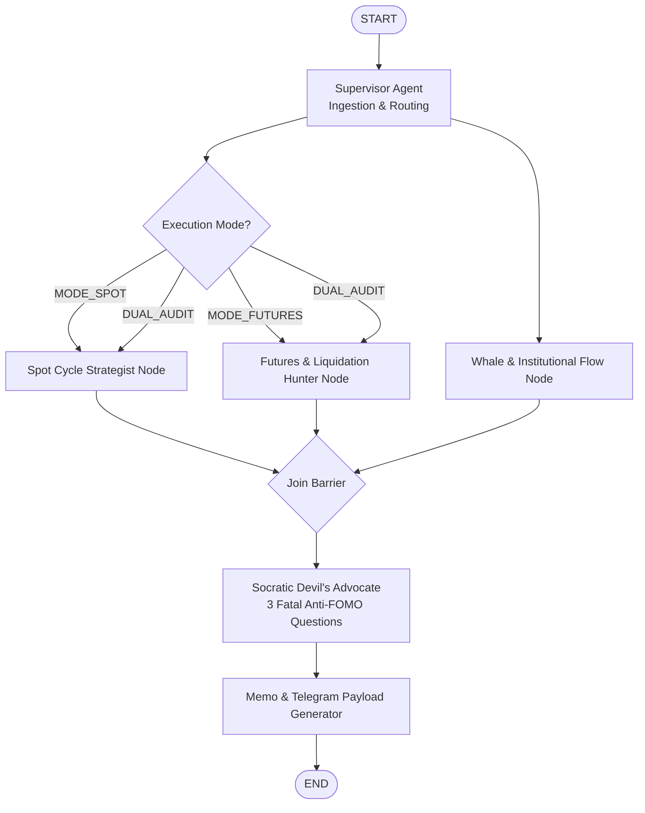

# Specification: REST API, WebSockets, Telegram Bot & LangGraph State Machine

## 1. LangGraph State Machine Architecture (`src/agents/state.py`)

### 1.1. Dual-Engine State Schema
```python
from typing import TypedDict, List, Dict, Any, Optional
from datetime import datetime

class SpecialistDossier(TypedDict):
    agent_id: str
    verdict: str
    confidence_score: float
    risk_level: str
    key_observations: List[str]
    critical_vulnerabilities: List[str]
    timestamp: datetime

class CryptoIntelState(TypedDict):
    # Immutable Quant Ingestion Contracts
    symbol: str
    timestamp: datetime
    execution_mode: str               # "MODE_SPOT", "MODE_FUTURES", or "DUAL_AUDIT"
    
    # Pre-calculated Quant Schemas (from src/engine/)
    spot_valuation_data: Optional[Dict[str, Any]]    # SpotCycleValuationSchema
    futures_squeeze_data: Optional[Dict[str, Any]]   # FuturesSqueezeSchema
    etf_flow_data: Optional[Dict[str, Any]]          # ETFNetflowSchema
    whale_flow_data: Optional[Dict[str, Any]]        # WhaleFlowSchema
    token_vesting_data: Optional[Dict[str, Any]]     # TokenVestingSchema
    
    # User Trade Context
    proposed_action: Optional[str]                   # e.g., "LONG_BTC_5X", "DCA_BUY_SPOT"
    proposed_entry: Optional[float]
    time_horizon_days: int
    
    # Parallel Specialist Nodes Output
    spot_dossier: Optional[SpecialistDossier]
    futures_dossier: Optional[SpecialistDossier]
    whale_etf_dossier: Optional[SpecialistDossier]
    
    # Socratic Devil's Advocate Inquisitor
    fomo_index: float
    fatal_socratic_questions: List[str]             # Exactly 3 Fatal Questions
    worst_case_invalidation_price: float
    thesis_refutations: List[str]
    anti_fomo_verdict: str
    
    # Delivery Payloads
    investment_memo: Optional[Dict[str, Any]]
    telegram_payload: Optional[Dict[str, Any]]
    execution_time_ms: float
    cache_hit: bool
    trace_id: str
    errors: List[str]
```

### 1.2. Graph Topology & Branching


---

## 2. API Endpoints Specification (FastAPI)

### 2.1. REST Endpoints
- `POST /api/v1/audit/trade`:
  - **Payload**: `{ "symbol": "BTCUSDT", "mode": "DUAL_AUDIT", "proposed_action": "LONG", "target_leverage": 5.0, "proposed_entry": 95000.0 }`
  - **Response**: Full audited state including Socratic questions and invalidation price.
- `GET /api/v1/spot/valuation/{symbol}`:
  - **Response**: MVRV Z-Score, 200W-MA ratio, Mayer Multiple, Algorithmic DCA & Take-Profit zones.
- `GET /api/v1/futures/risk/{symbol}`:
  - **Response**: FRSI, OI Divergence, Liquidation cluster prices, Orderbook imbalance.
- `GET /api/v1/institutional/flows`:
  - **Response**: Spot ETF 5-day netflows (BlackRock/Fidelity) + Tether minting velocity.

### 2.2. WebSocket Streaming Endpoints
- `ws://localhost:8000/ws/v1/telemetry/{symbol}`:
  - Real-time 1-second broadcast of ticker, funding APR, orderbook imbalance, and live squeeze alerts.

---

## 3. Telegram Webhook Handler (`src/bot/telegram_bot.py`)

### 3.1. Commands Supported
- `/start`: Welcome message, command syntax guide, and disclaimer.
- `/audit <symbol>`: Triggers full Multi-Agent Socratic audit on `<symbol>` (e.g. `/audit BTC`, `/audit ETH`, `/audit SOL`).
- `/spot <symbol>`: Quick cycle valuation card (MVRV, Realized Price, DCA zones).
- `/futures <symbol>`: High-frequency squeeze risk card (Funding APR, OI Delta, Liquidation pockets).
- `/subscribe`: Subscribes chat ID to real-time whale dumps, Tether minting, and extreme squeeze alerts.

### 3.2. Telegram Message Response Layout
```
🚨 CRYPTOINTEL AUDIT: BTCUSDT
Price: $95,200 | Mode: DUAL_AUDIT

📊 QUANTITATIVE VITALS:
• MVRV Z-Score: 3.82 (Late Bull / Overheated)
• Funding APR: 87.6% (Extreme Long Squeeze Hazard)
• 24h Netflow: +$420M CEX Inflow (Whale Distribution)
• ETF Flow (5d): -$180M (Institutional Outflow)

🔥 SOCRATIC DEVIL'S ADVOCATE (FOMO Index: 89/100):
Verdict: REJECT_SETUP_TOO_RISKY
Worst-Case Invalidation Price: $90,800 (-4.6%)

❓ 3 FATAL QUESTIONS BEFORE YOU BUY:
1. Funding APR is 87.6%. Can your capital survive the funding bleed if price chops for 4 days?
2. Whales moved $420M BTC to spot exchanges today. Why are you buying their exit liquidity?
3. If market makers wick down 4.6% to sweep the $90,800 long liquidation pool, will your position survive?

⚠️ Digital Asset Risk Disclaimer: Not financial advice.
```
